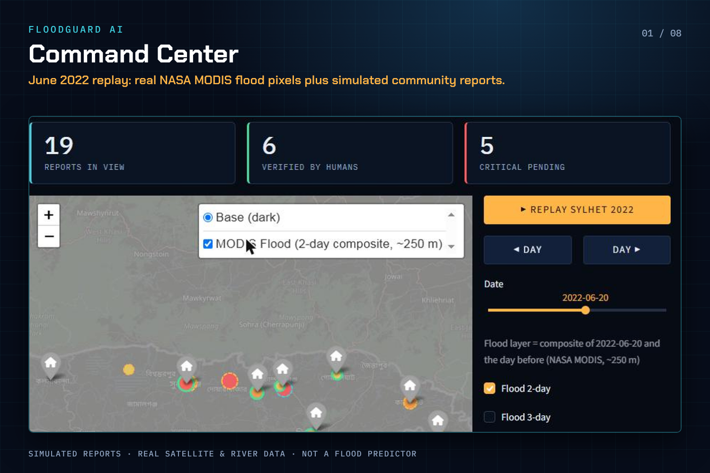

# ◆ FloodGuard AI · বন্যা সতর্কতা

**Satellites see the water; people see the damage. FloodGuard connects both, with a human in the loop.**

Built for the **STEM2Connect AI Hackathon 2026** · Track: Community Impact · Bangladesh-first, usable anywhere.

> 🔗 Live demo: _(add Streamlit URL)_ · 🎬 Demo video: _(add YouTube URL)_ · 📝 Devpost: _(add URL)_



## Problem
- June 2022: floods in north-east Bangladesh affected **7.2 million people**; about 94% of Sunamganj district was under water (UN RCO, IFRC).
- Satellites show where water is, but not who is trapped on a roof. Citizens know the damage, but their reports are unstructured, duplicated, unverifiable and arrive in Bangla, English or both.

## What it does
- **Report** a flood in Bangla or English (text, optional photo, map location). No accounts, no contact fields.
- **AI structures** it: category, urgency, needs, people affected, summary. Personal data is removed first.
- **Detects** duplicate / corroborating reports and re-shared photos.
- **Sets each report against NASA satellite flood imagery and GloFAS river-discharge context** ("evidence is context, never proof").
- **Human moderators** verify or reject. AI can never mark a report verified. Every action is audited.
- **Responders** get a prioritised map, analytics and a one-click situation report.
- **Event Replay**: the June 2022 Sylhet–Sunamganj flood with real NASA/GloFAS data and clearly labelled **SIMULATED** reports.

## How it works
```
report → redact PII → AI analysis (pre-computed Gemini → limited live Gemini → rule-based) → store
       → dedupe / photo hash → satellite + river evidence → priority score → map / moderator / SitRep
```
Three-tier AI so the demo never breaks on free-tier limits; every result shows which engine made it.
Details: [docs/architecture.md](docs/architecture.md) · [docs/SPEC.md](docs/SPEC.md) · [docs/threat_model.md](docs/threat_model.md).

## Run locally
```bash
py -3.11 -m venv .venv && .venv\Scripts\activate      # Windows (Linux/macOS: python3 -m venv .venv && source .venv/bin/activate)
pip install -r requirements.txt
streamlit run app.py
```
Works with **no keys and no internet** in replay mode (rule-based + cached data). Run tests: `python -m pytest -q`.

## Configuration (Streamlit secrets or environment)
| Key | Default | Note |
|---|---|---|
| `GEMINI_API_KEY` | none | enables live Gemini; never commit it |
| `GEMINI_MODEL` | `gemini-3.5-flash-lite` | current Flash-Lite; falls back to 3.5-flash, 3.8-flash, 3.1-flash-lite (2.5 is closed to new keys) |
| `MODERATOR_PIN` | `2468` | **change it** for any public deployment |
| `LIVE_AI_SESSION_CAP` / `LIVE_AI_DAILY_CAP` | 3 / 150 | protects free-tier quota |

Optional data refresh (needs internet, run locally): `python scripts/check_sources.py`, `python scripts/precompute_evidence.py`, `python scripts/precompute_gemini.py` (needs your key), `python scripts/run_eval.py`.

## Data sources and honesty
- **Real:** NASA GIBS MODIS flood product (MCDWD, ~250 m) and Terra true colour; GloFAS v4 modelled river discharge via Open-Meteo.
- **Simulated:** every Event Replay report and every shelter (tagged SIMULATED / DEMO in the app, exports and video).
- Not a flood predictor. Satellite pixels miss small, flash and under-canopy flooding and can show cloud-shadow false positives.

## Privacy and safety
Redaction of phones, emails, names, IDs and links before any AI call · only redacted text + district name leave the app (never photos or coordinates) · ~500 m public location blur · EXIF/GPS stripped · upload validation · PIN-protected moderator desk with lockout · no personal data in logs. See the threat model.

## Evaluation
See [docs/eval_results.md](docs/eval_results.md): 30 bilingual reports; rule-based tier reported separately on the tuned set and on 12 held-out items. Small, author-labelled, a sanity check and not a benchmark.

## Limitations
Demo deployment has a temporary disk (submissions reset when the app restarts) · MODIS Terra/Aqua are ageing satellites · free-tier Gemini limits are not guaranteed · simulated reports and demo shelters only · Bangla keyword fallback is basic.

## AI disclosure
**In the product:** Google Gemini (free tier, model set by `GEMINI_MODEL`) structures redacted report text into JSON and drafts situation reports. Each output is labelled live, pre-computed or rule-based. Gemini never verifies reports.
**In building it:** Anthropic's Claude (Claude Code: Opus for the specification and review, Sonnet for most of the code and tests) wrote the specification and most of the implementation. The author chose the project, scope, data sources and track and directed the work. _(Author: edit this paragraph to list exactly what you reviewed, tested or changed yourself.)_

## Credits
See [CREDITS.md](CREDITS.md). License: MIT.
